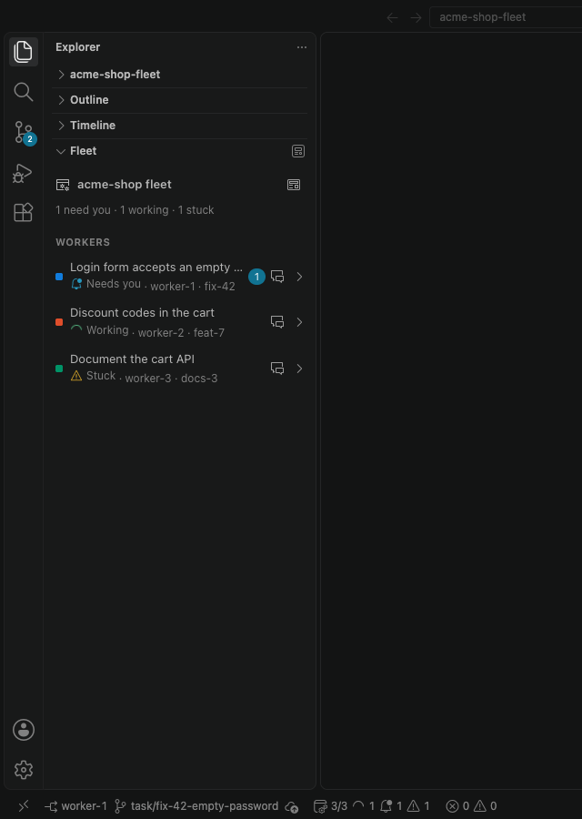
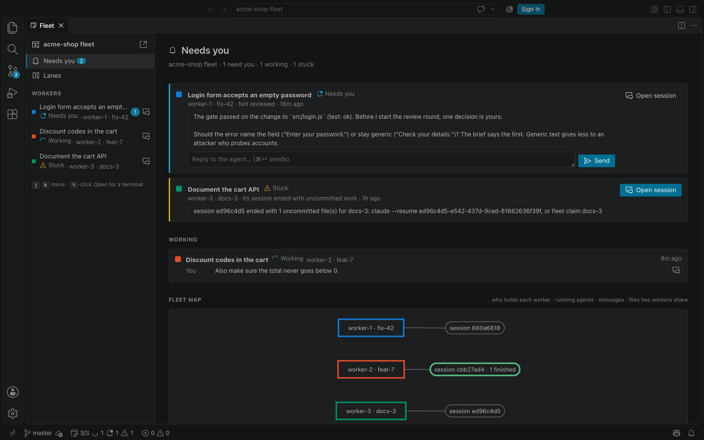
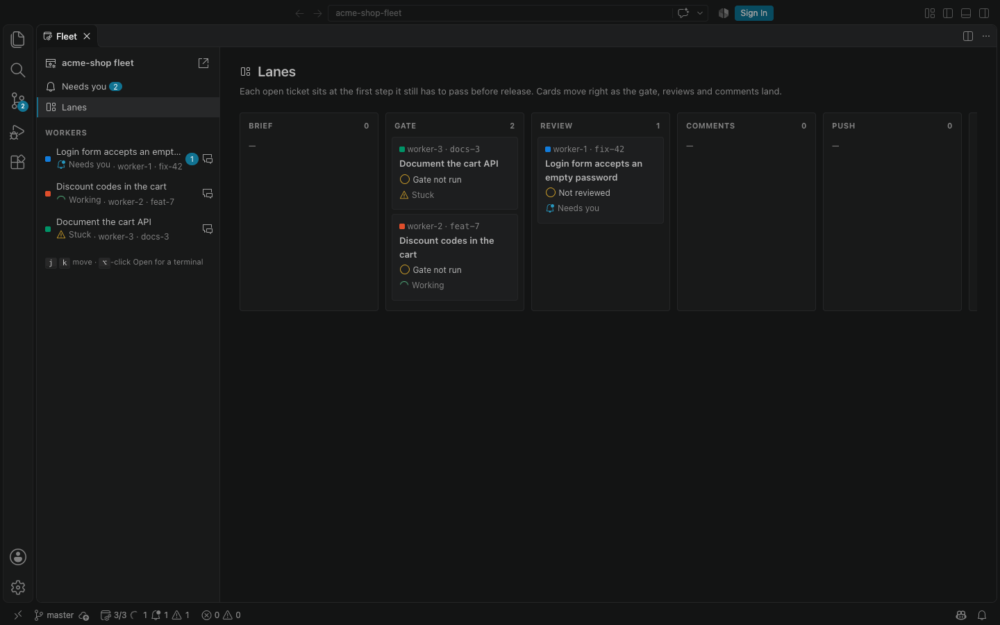
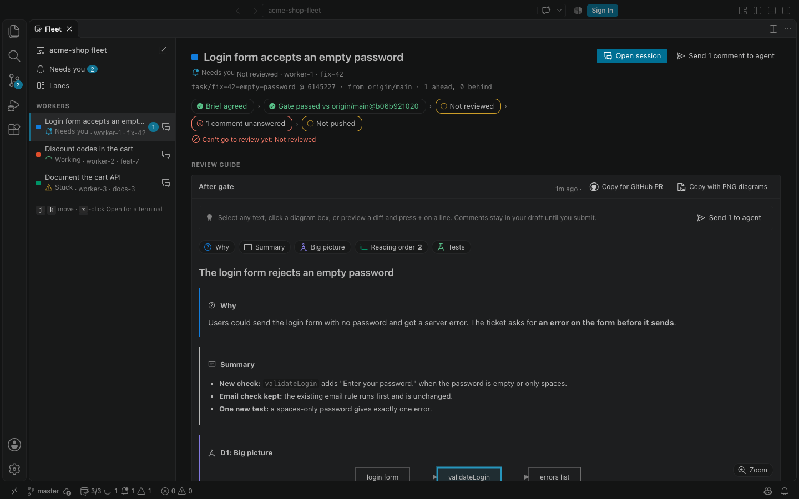
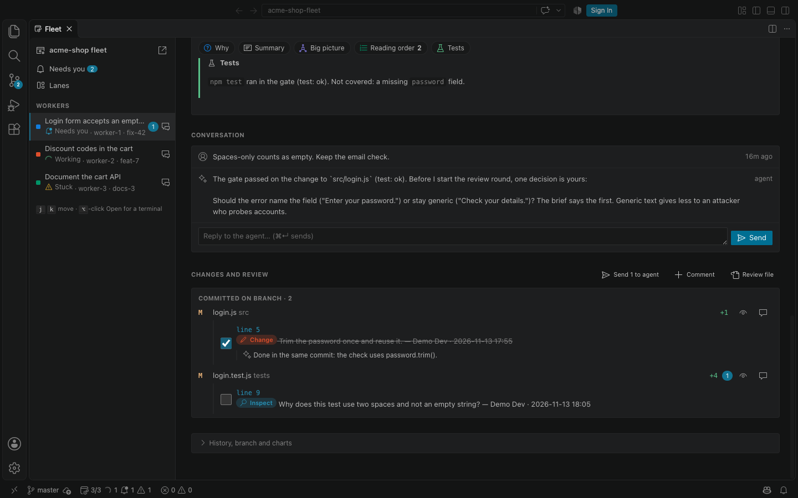
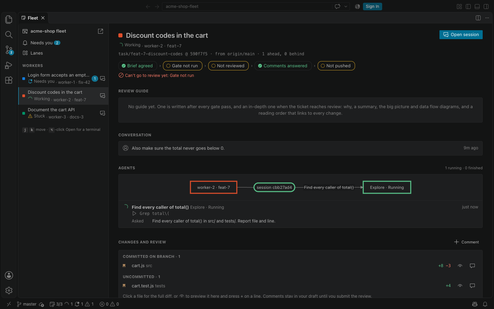
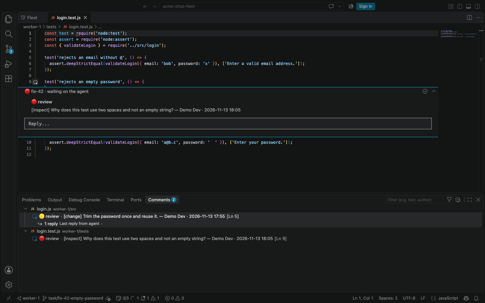

# Bosun

The bosun checks the crew's work before it reaches the captain.

Bosun runs several Claude Code agents in parallel, each in its own git worktree.
It gives you an agent's work only when it can prove that the work holds up.

- **Gate tied to the code.** `fleet gate` runs your checks on the worker and on its
  merge-base, and records the result against a tree id of the exact code, uncommitted
  changes included. Change one line and the pass no longer counts.
- **Briefs before edits.** The agent agrees acceptance criteria with you first. The
  brief becomes the reviewer's spec.
- **Review rounds with a cap.** A headless reviewer checks the work against the brief.
  Blocking findings go back to the agent. After the last round, a human decides.
- **Work that survives sessions.** Each task keeps a record of its branch and notes,
  so the next agent resumes where the last one stopped, even after a restart.
- **Fleet View.** A VS Code dashboard that shows which workers need you, plus line
  comments that reach the agent on its next prompt.

Status: early, and built on Claude Code internals that may change between releases.

## Words used in this README

| Word | Meaning |
|---|---|
| Fleet | A folder beside your repository. It holds the workers, `fleet.conf` and the task records. |
| Worker | One working copy of your repository (a git worktree) in the fleet folder. One agent uses one worker at a time. |
| Task | One unit of work, with a key such as `fix-42`. Each task has one branch and one record. |
| Claim | An agent locks a free worker for a task. Release unlocks it. |
| Lease | The time a claim stays valid without activity (`LEASE_HOURS`). Each `fleet note` renews it. |
| Brief | A short file with the goal and acceptance criteria that you agree with the agent. |
| Gate | Your checks (tests, typecheck). Bosun runs them on the task branch and on the merge-base. |
| Merge-base | The commit where the task branch left the base branch. The gate compares against it, so old failures do not block the task. |
| Beads | The tool (`bd`) that stores the task records. You do not use it directly. |

## What you need

- macOS or Linux, with git, jq, node and [Beads](https://github.com/steveyegge/beads).
  On macOS: `brew install git jq node beads`.
- [Claude Code](https://docs.claude.com/en/docs/claude-code).
- VS Code, for Fleet View. The `code` command must be on your PATH.
- Two Claude Code plugins, for the brief and review steps. See
  [Skills that Bosun uses](#skills-that-bosun-uses).

Make sure that each tool runs: `git --version`, `jq --version`, `node --version`,
`bd version`, `claude --version`.

`install.sh` changes `~/.claude/settings.json`. It adds three hooks, and it keeps a
copy of the old file as `settings.json.bak-<time>`.

## Getting started

This example sets up a fleet of three workers for one repository, then gives an agent
its first task. It uses `~/code/myrepo` as your clone. Change the paths to suit you.

1. Get Bosun and install it.

   ```bash
   git clone git@github.com:nkoda/Bosun.git ~/code/Bosun
   cd ~/code/Bosun && ./install.sh
   ```

2. Install the two plugins. Run these commands inside Claude Code:

   ```text
   /plugin install mattpocock-skills@claude-plugins-official
   /plugin marketplace add DietrichGebert/ponytail
   /plugin install ponytail@ponytail
   ```

3. Make a fleet folder beside your clone, and copy the example config into it.

   ```bash
   mkdir ~/code/myrepo-fleet
   cp ~/code/Bosun/engine/fleet.conf.example ~/code/myrepo-fleet/fleet.conf
   ```

4. Edit `~/code/myrepo-fleet/fleet.conf`. For a first fleet, these keys are enough:

   ```bash
   REPO=/Users/you/code/myrepo        # your clone; write the full path, not ~
   WORKERS="worker-1 worker-2 worker-3"   # names of the worker folders to create
   BASE_BRANCH=main                   # agents cut task branches from origin/main
   GATE="
   test|test|src/ tests/|npm test --silent
   "
   BRIEF_REQUIRED=1                   # the agent agrees a brief with you before edits
   REVIEW_ROUNDS=2                    # a fresh Claude reviews the work, 2 rounds at most
   ```

   A `GATE` line has four fields, split by `|`:

   - **name** — a label for the check, for example `test`.
   - **kind** — `test` fails only when the check passes on the merge-base and fails
     on the branch. `typecheck` fails on each error line that the merge-base does not
     have.
   - **path prefixes** — the check runs only when a changed file starts with one of
     these. Leave it empty to run the check every time.
   - **command** — the shell command to run in the worker.

   `BRIEF_REQUIRED` and `REVIEW_ROUNDS` are `0` (off) if you do not set them. Task keys
   can use letters, digits, `.`, `_` and `-`. To allow only ticket keys, set
   `TASK_KEY_PATTERN`. `fleet.conf.example` explains every other key.

5. Write `~/code/myrepo-fleet/FLEET_POLICY.md`. Each agent reads it before it starts.
   Plain Markdown is enough:

   ```markdown
   # Fleet policy: myrepo

   - Branch name: `task/<key>-<short-slug>`, for example `task/fix-42-empty-password`.
   - Never push to `main`. A task ends at a pushed task branch.
   - Run `npm run lint` before you release a task for review.
   ```

6. Make the task store and the workers. `init` makes the task store in
   `myrepo-fleet/beads/`. `provision` makes `main/` (a read-only copy of the base
   branch) and one folder for each worker.

   ```bash
   ~/.claude/fleet/fleet -f ~/code/myrepo-fleet init
   ~/.claude/fleet/fleet -f ~/code/myrepo-fleet provision
   ~/.claude/fleet/fleet -f ~/code/myrepo-fleet status
   ```

   `status` shows three free workers. `fleet` is not on your PATH. Add an alias if you
   want a short name: `alias fleet='~/.claude/fleet/fleet -f ~/code/myrepo-fleet'`.

7. Open `~/code/myrepo-fleet` in VS Code. If VS Code asks whether you trust the
   authors of the files, click **Trust**. In Restricted Mode, VS Code does not run
   Fleet View. Then run **Developer: Reload Window** from the command palette. The
   **Fleet** section is at the bottom of the Explorer. The extension starts the
   dashboard server for you. See [A tour of Fleet View](#a-tour-of-fleet-view).
8. Open a terminal in `~/code/myrepo-fleet`, start `claude`, and give it a task:

   ```text
   /bosun Task fix-42: the login form accepts an empty password. Make it show an error.
   ```

### What happens next

1. The agent claims a worker, for example `worker-1`, and makes the task branch.
2. The agent asks you questions about the task. When you agree, it writes
   `briefs/fix-42.md`.
3. The agent changes the code in `worker-1/` and runs the gate.
4. A fresh Claude reviews the change. The agent fixes or answers each finding.
5. The agent pushes the task branch to `origin` and releases the worker.

At the end, the agent tells you the branch name, the `[gate]` result and the
`[review]` result. It also tells you what you must still decide. The task is now
ready for you. Review the branch, then merge it as usual, for example through a pull
request. After the merge, run `fleet gc`. It lists the task as `close`. Then run
`fleet gc --apply` to close the task record.

## Using the skill

The `bosun` skill tells an agent how to work in a fleet. Start it in one of these
ways:

- Type `/bosun` and then the task, as in step 8 above.
- Ask for a task in a folder that holds a `fleet.conf`. The agent loads the skill
  when it sees the fleet.
- Add a short project skill that names the fleet folder and points to `bosun`. See
  [A project skill](#a-project-skill).

### What the agent does

For each task, the agent follows these steps. Each step is a `fleet` command, so the
locks and the task record stay accurate.

1. **Claim.** `fleet claim <TASK>` gives the agent a free worker and a task branch. If
   the task has a record, the agent resumes its branch and reads the earlier notes.
2. **Brief.** With `BRIEF_REQUIRED=1`, the agent asks you questions until the acceptance
   criteria are clear. It writes them to `briefs/<TASK>.md`. Edits stay blocked until
   the brief exists.
3. **Work.** The agent commits on the task branch and records progress with `fleet note`.
4. **Gate.** `fleet gate` runs your checks on the worker and on the merge-base. It
   fails only on what this branch broke.
5. **Review.** With `REVIEW_ROUNDS` set, `fleet review` starts a new read-only Claude.
   That reviewer checks the change against the brief. Its findings become review comments.
6. **Push.** The agent rebases on the base branch and pushes the task branch. It
   never pushes to the base branch.
7. **Release.** `fleet release --state review` frees the worker. The engine refuses
   this until the gate passes, the review passes and each comment has a reply.

### What you can tell the agent

| You say | The agent does |
|---|---|
| `/bosun Task <KEY>: <what to do>` | Claims a worker and starts or resumes that task. |
| "Continue `<KEY>`" | Resumes the task from its branch, its notes and the last gate result. |
| "Start `<KEY>` fresh" | Uses `--fresh`. The old branch stays as `salvage/<branch>-<time>`. |
| "Pause here" | Releases with `--state paused` and a handoff note for the next agent. |
| "Show the fleet" | Runs `fleet status`. |
| "Clean up the fleet" | Runs `fleet gc`, then `fleet gc --apply` only if you agree. |

`<KEY>` must match `TASK_KEY_PATTERN` in `fleet.conf`.

### Review comments

Add line comments in Fleet View, or write them in
`<fleet>/scratchpad/reviews/<TASK>.md`. The agent sees open comments on its next prompt.
It ticks each one and writes a `> ` reply. To ask again, add a `>> ` line under the reply.

### Skills that Bosun uses

The `bosun` skill comes with this repo. Three skills from two plugins do the brief
and review steps:

| Skill | Plugin | Used by | What it does |
|---|---|---|---|
| `mattpocock-skills:grilling` | `mattpocock-skills@claude-plugins-official` | Brief (`BRIEF_REQUIRED=1`) | Asks you questions until the agent does not have to guess any decision. |
| `mattpocock-skills:code-review` | `mattpocock-skills@claude-plugins-official` | `fleet review` (`REVIEW_ROUNDS`) | Checks the diff against the brief and the repo's coding standards. |
| `ponytail:ponytail-review` | `ponytail@ponytail` | `fleet review` (`REVIEW_ROUNDS`) | Finds code that the change does not need. |

Install the plugins as in step 2 of [Getting started](#getting-started). Without
`BRIEF_REQUIRED` and `REVIEW_ROUNDS`, Bosun does not need them.

The `asd-ste100` skill ([danyuchn/asd-ste100-skill](https://github.com/danyuchn/asd-ste100-skill))
is optional. Bosun does not call it. This README follows it, and a fleet policy can tell
agents to use it for briefs and notes.

### A project skill

A project skill gives the agent the fleet folder and any project rules. Put it in
`~/.claude/skills/<repo>-fleet/SKILL.md`:

```markdown
---
name: myrepo-fleet
description: Use before any task that edits myrepo. Claims a fleet worker for the task.
---

The fleet folder is `~/code/myrepo-fleet`. Follow the `bosun` skill with
`FLEET=~/code/myrepo-fleet`. Read `FLEET_POLICY.md` before you start.
```

Keep project rules in `FLEET_POLICY.md`, not in the skill. Then each agent reads the
same rules. For notes that agents must keep, such as known gate failures, add an
optional `FLEET.md` beside it.

### When a worker is stuck

`fleet status` shows the state of each worker. The `bosun` skill tells the agent what
to do for each state. If a session stopped with uncommitted work, the worker shows
`INTERRUPTED`. Claim the same task again to continue the work. You can also resume
the old session with `claude --resume <session>`.

## A tour of Fleet View

These screenshots come from a demo fleet for a small shop app. It has three workers
and four tasks.

### The Fleet section and the status bar



The **Fleet** section at the bottom of the Explorer lists one row for each worker. Each
row shows the task title, its phase, the worker and the task key. The phases are:

- **Needs you** — the agent stopped and waits for your answer or your review.
- **Working** — the agent is busy.
- **Stuck** — the session ended, often with uncommitted work.
- **Ready for review** — the gate and the review passed.
- **Idle** — no task.

The blue number counts open review comments. Click a row to open its worker page. The
item in the status bar shows busy workers out of all workers (`3/3`). It then shows a
count for each phase: working, needs you, ready for review and stuck. Hover over it
for one line per worker.

### Needs you



Run **Fleet: Open Dashboard** to open this page. It shows one card for each thing that
you must do, the most urgent first. In this example:

1. The agent on `fix-42` asks a question. Type the answer in the box and click **Send**.
2. The session on `docs-3` ended with uncommitted work. The card gives the
   `claude --resume` command. **Open session** opens that conversation.

Below the cards are the agents that still work, and the **Fleet map**. The map shows
which session holds each worker, and the agents that each session runs. Press
<kbd>j</kbd> and <kbd>k</kbd> to move between pages.

### Lanes



**Lanes** puts each open task in the column of the first step that it did not pass.
The columns are Brief, Gate, Review, Comments, Push and ready for a person. A task moves
right when it passes a step.

### A worker page



Click a worker to open its page. The top shows the branch and how far it is ahead of
the base branch. The row of steps shows what passed (green) and what did not (yellow
or red). The red line tells you why the task cannot go to review yet.

The **review guide** explains the change for a reviewer: why, a summary, diagrams,
the order to read the files, and the tests. Fleet View writes a guide after each gate
pass, with `claude -p`. Select text in the guide to add a draft comment on it. Drafts
go to the agent only when you click **Send**.



Below the guide are the conversation, a reply box, and **Changes and review**. That
section lists each changed file with its review comments. A ticked comment has the
agent's reply under it. Click a file to see the diff.



When a session starts helper agents, the **Agents** section shows them. For each agent,
it shows what the agent does now and what the session asked it.

### Review comments in the editor



Open a file in a worker to see its review comments in the editor. To add one, click
the **+** next to a line number. Then pick **Inspect** (explain this), **Review**
(check for problems) or **Change** (make this change). The colour of a thread shows
its state:

- 🔴 The agent did not answer yet.
- 🟡 The agent answered. It is your turn.
- 🟢 You clicked **Mark complete**.

Click **Reply** to ask again. The **Comments** panel lists all the threads.

## What is in this repo

The tools live in three folders. `install.sh` links them into place, so this repo
stays the single source:

- `engine/fleet` — the coordination script that every fleet skill calls. It locks each
  worker through `.locks/<worker>/owner` (session, pid, task, branch, lease). Each task
  keeps one Beads record, so a later agent resumes the same branch and notes. Configure
  a fleet with `<fleet-dir>/fleet.conf`. See `engine/fleet.conf.example`. `fleet claim`
  and `fleet note` also print the task's open review comments. `engine/fleet-guard` is
  a hook that blocks edits outside your claimed worker, and edits before the brief exists.
- `skills/bosun/SKILL.md` — the Claude Code skill with the shared protocol:
  claim, resume or start fresh, leave notes, answer review comments, run the gate,
  push for review, release. Project rules (gate commands, branch naming, protected
  branches) stay in each fleet's own `FLEET_POLICY.md`.
- `fleet-view/` — a VS Code extension plus a local live server (`server.js`). There is
  one server per fleet on `127.0.0.1:7420`, with token and Host checks. It shows occupancy,
  sessions, per-worker changes, charts, Mermaid diagrams and review comments. `hook.js` is a
  Claude Code hook (UserPromptSubmit and Stop) that records what each session is doing
  and hands new review comments to the agent.

### What install.sh does

It symlinks `~/.claude/fleet/fleet`, `~/.claude/fleet/fleet-guard`,
`~/.claude/fleet/fleet-view` and `~/.claude/skills/bosun` to this checkout. It links the
VS Code extension to the same folder. It adds `hook.js` and `fleet-guard` to
`~/.claude/settings.json`. The script keeps anything already in place as
`<path>.bak-<timestamp>`. You can run it again safely. The links point into this
checkout, so keep it on a branch that has these files.

Self-checks: `engine/test_fleet.sh`, `node fleet-view/review.js` and `node fleet-view/gather.js <fleet-dir>`.

## License

MIT. See `LICENSE`.
