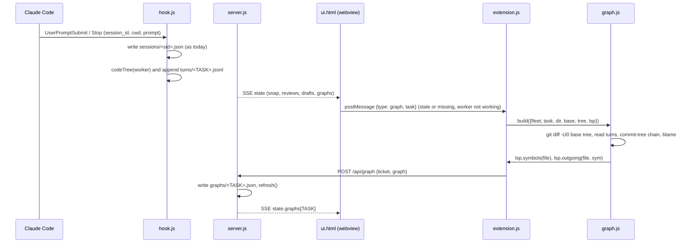

# Change graph: technical scope and plan

Date: 2026-11-18. Branch: `feature/change-graph`.

**The question v1 answers:** *What did this worker change, how do the pieces connect, and which prompt did each piece come from?*

**Terms used here:**
- **Change graph:** the feature.
- **Chain:** a group of changes connected through calls.
- **Turn:** one prompt and the agent's work up to its Stop.
- **Linking node:** an unchanged function that joins two changed ones.

Use these words in code, UI and docs.

---

## 1. Libraries

Rule: use what is already in Fleet View or in VS Code. v1 adds **no new dependency** and **no CSP change**.

| Concern | Choice | Why | Alternatives rejected |
|---|---|---|---|
| Symbol extraction | `vscode.executeDocumentSymbolProvider` (built in; `engines.vscode ^1.90` is enough) | Uses the user's own language servers, with no dependency. Workers sit inside the fleet folder that README step 7 opens, so tsserver, Pylance and others index them normally. | **web-tree-sitter 0.27.2:** needs a `.wasm` grammar per language. In the extension host that means vendoring WASM with no `node_modules`. In the webview it needs `'wasm-unsafe-eval'` and a `connect-src` for the wasm, which is a CSP change. It gives syntax only, with no name resolution. Keep it as the later fallback for languages with no language server. |
| Call edges | `vscode.prepareCallHierarchy` + `vscode.provideOutgoingCalls` | Real resolved calls, so edges are never invented. Outgoing calls from changed symbols are enough to find edges between changed symbols and one-hop linking nodes. | **`provideIncomingCalls`:** this is blast radius, which is not in v1. **`executeReferenceProvider`:** includes imports, types and non-call references, so it is noisy. **tree-sitter:** no resolution, regex-grade edges. |
| Diff parsing | `git diff -U0 --no-color --no-renames --no-ext-diff --src-prefix=a/ --dst-prefix=b/ <mergeBase> <tree>` plus a ~15-line parser in `graph.js` (the same `@@ -a,b +c,d @@` regex as `diffView()` in `ui.html`) | Diffing against the **tree id** covers uncommitted and untracked files exactly as the gate sees them. | `parse-diff` or `diff2html` would need `node_modules`. |
| Per-prompt snapshots | `codeTree()` from `gather.js` (the Node twin of `tree_id()` in `engine/fleet`), called by `hook.js` on UserPromptSubmit and Stop | Exact whatever tool made the edit (Edit, Write, Bash, formatters). The code already exists. | Parsing `tool_use` entries in the transcript misses Bash and codegen edits. `git stash create` skips untracked files. Shelling out to `fleet` pays bash and config startup inside a 5-second hook. |
| Which turn wrote a line | Deterministic `git commit-tree` chain (base, then P1, S1, P2, S2, … then the current tree) and `git blame --porcelain` | Exact, and it follows lines as they move. Fixed author and date make the commit ids stable, so nothing needs to be stored. | Matching symbol names per turn breaks because line numbers differ between trees. git notes or Agent Trace: later. |
| Graph layout | Mermaid's built-in dagre layout (`flowchart LR`, one subgraph per file) | Already loaded. Deterministic for the same input, so the layout holds still when only classes change. | **ELK (elkjs 0.12.1):** 1.6 MB bundle, and Mermaid's ELK layout needs the ESM `@mermaid-js/layout-elk` loader. **d3-force:** unstable layout. |
| Rendering | **Mermaid 11**, already in `ui.html`: `https://cdn.jsdelivr.net/npm/mermaid@11/dist/mermaid.min.js`, which resolves to **11.17.2** today. Do not move to 12.x (12.3.0 exists). | No new code to load. Theming, caching (`mmdCache`), PNG export and click wiring already exist. Readable up to about 60 nodes. | **Cytoscape.js:** the later upgrade (below). **React Flow (@xyflow/react 13.0.2):** needs React and a JSX build. **D3 7.9.2:** a renderer written by hand. |
| Interaction | Plain DOM listeners on the Mermaid SVG (the pattern in `wireDiagrams()`), CSS classes for select, nearby and dim, and the existing `popover()`, `annotate()`, `togglePeek()` and `act('diff')` | Everything is already there. Toggling classes means no re-render and no layout shift. | — |

**Upgrade path, when graphs pass about 60 symbols or need pan and zoom:**
- Cytoscape.js **3.35.0**: `https://cdn.jsdelivr.net/npm/cytoscape@3.35.0/dist/cytoscape.min.js` (443 KB). Its compound nodes fit directory ⊃ file ⊃ symbol.
- cytoscape-dagre **4.1.0**: `https://cdn.jsdelivr.net/npm/cytoscape-dagre@4.1.0/dist/cytoscape-dagre.min.js` (46 KB). It bundles `@dagrejs/dagre` and registers itself on `window.cytoscape`.

The graph JSON below does not depend on the renderer, so this swap touches only `ui.html`.

**CSP check:**
- `extension.js` `html()` (line 218) sets `script-src 'nonce-…' https://cdn.jsdelivr.net`. `server.js` `page()` (line 191) sets the same.
- Mermaid already loads under this policy. Cytoscape and cytoscape-dagre would also load: same host, `<script nonce="__NONCE__">` tags, and canvas drawing needs nothing more.
- Under this policy, web-tree-sitter cannot load (no `wasm-unsafe-eval`, and `connect-src` is limited to the Fleet View server), and ELK's web-worker build is blocked (`default-src 'none'`). This is one more reason to reject both.

---

## 2. Architecture

### 2.1 Where each part is computed

| Part | Where | Why |
|---|---|---|
| Turn snapshots | `hook.js` (Claude Code hook process) | Only the hook sees the exact moment of the prompt and the stop. |
| Diff, which turn wrote each line, chains | `fleet-view/graph.js` (new; plain Node with `execFile` git), called from the extension host | Pure logic, testable with `node fleet-view/graph.js` and a stub language server. |
| Symbols and call edges | `extension.js`, through an adapter passed to `graph.build()` | The call-hierarchy commands exist only in the extension host. |
| Storage and fan-out | `server.js` | One copy for the sidebar, the dashboard tab and the browser page. Follows the reviews and drafts pattern. |
| Drawing and interaction | `ui.html` | Mermaid text is generated in the page, like `changeMap()` and `fleetGraph()`. |

### 2.2 Flow



### 2.3 Storage

| What | Where | Format |
|---|---|---|
| Turn events | `<fleet>/.fleet-view/turns/<TASK>.jsonl` (append only) | `{"at":ISO,"event":"prompt"\|"stop","session":uuid,"worker":"worker-1","task":"T-1","tree":"<sha>","prompt":"<first 300 chars, prompt events only>"}` |
| Latest graph per task | `<fleet>/.fleet-view/graphs/<TASK>.json` | Graph, below. Its `tree` field is the cache key. |
| Git objects | The repo's object database | Trees written by `codeTree`, and the fixed-date chain commits. Nothing points to them, the same as the gate's trees. |

### 2.4 Data model (the contract between tasks)

```json
{
  "v": 1, "task": "T-1", "tree": "<40 or 64 hex>", "base": "<mergeBase sha>", "builtAt": "ISO",
  "lsp": { "files": 5, "withSymbols": 4 },
  "truncated": false,
  "turns": [{ "n": 1, "at": "ISO", "session": "uuid", "prompt": "first 300 chars" }],
  "nodes": [{ "id": "src/a.js#Cart.total", "file": "src/a.js", "name": "Cart.total", "kind": "method",
              "line": 10, "endLine": 24, "status": "modified", "add": 3, "del": 1, "turn": 2, "firstTurn": 1 }],
  "edges": [{ "from": "src/a.js#Cart.total", "to": "src/b.js#tax" }],
  "chains": [["src/a.js#Cart.total", "src/b.js#rate", "src/b.js#tax"]]
}
```

**Nodes**
- `id` is `file#Outer.inner`. A whole-file node has `id = file` and `kind: "file"`.
- `status` is one of:
  - `added`: every line of the symbol is new.
  - `modified`.
  - `deleted`: whole files only.
  - `context`: an unchanged linking node, with `add`/`del` of 0 and no turn.
- `turn` is the latest turn that wrote a surviving changed line in the node. `firstTurn` is the earliest. `null` means "not from a recorded turn": edits between turns, edits made before snapshots existed, or edits after the last Stop.
- `line` and `endLine` are 1-based, in the current tree.

**Symbol rules**
- A changed line goes to the **innermost** symbol of a kept kind that contains it.
- Kept kinds: function, method, constructor, class, interface, enum, struct, module, namespace. Variables and constants count only at depth 0, so top-level JS/TS arrow functions are included.
- A line outside every kept symbol counts toward a file node. So does every line of a file where the language server returns no symbols.
- A pure deletion hunk (`+c,0`) is anchored at line `c`.

**Edges and linking nodes**
- Call `lsp.outgoing` for each changed function, method or constructor. Keep a target that is a changed node.
- For targets that are unchanged and inside the worker, call `outgoing` once more, for 40 candidates at most. If such a target reaches a different changed node, add it as a `context` node with both edges.
- Ignore targets outside the worker directory or under `node_modules`.

**Chains**
- A chain is a connected component with 2 or more nodes. Within it, nodes are in topological order (Kahn's algorithm), with ties and cycles broken by file and line.
- Chains are sorted largest first. Single nodes are listed as "standalone".

**Turns**
- Sort the events by `at`. Each `prompt` opens turn `n+1`; the next `stop` closes it.
- Chain commits:
  - base = `mergeBase`;
  - `P_n` = the tree at prompt n, labelled `null`;
  - `S_n` = the tree at stop n, labelled `n`;
  - the last commit = the current tree, labelled `n` if the last event was a prompt with no stop (a turn still running), otherwise `null`.
- Use the last 100 events at most. Skip a commit whose tree is the same as its parent's.
- Blame **only the new-side hunk ranges** with `-L`.

**Caps and exclusions**
- More than **60** changed symbols: emit file nodes and file-to-file edges only, and set `truncated: true`.
- Each language-server call times out after 5 s. The whole build stops after 90 s; whatever is finished by then is kept, with `truncated: true`.
- Excluded paths, as `:(exclude)` pathspecs: `**/package-lock.json`, `**/yarn.lock`, `**/pnpm-lock.yaml`, `**/Cargo.lock`, `**/poetry.lock`, `**/go.sum`, `**/*.min.js`, `**/*.map`. A binary file becomes a file node with no line counts.
- `# ponytail: fixed exclude list; make it a fleet.conf key when someone asks.`

### 2.5 Interfaces

```js
// fleet-view/graph.js
async function build({ fleet, task, dir, base, tree, lsp, max = 60 }) // -> Graph (2.4)
function parseHunks(diffText)        // -> { [file]: [{ os, oc, ns, nc }] }  (1-based, -U0)
function readTurns(fleet, task)      // -> [{ at, event, session, tree, prompt }]
function chains(ids, edges)          // -> [[id, ...]]
// lsp adapter, supplied by extension.js (stubbed in the self-check):
//   symbols(absFile)      -> Promise<[{ name, kind, line, endLine, selLine, selChar, depth }]>   flattened, 1-based
//   outgoing(absFile, s)  -> Promise<[{ file, name, kind, line, endLine, selLine, selChar }]>
```

The extension adapter must also handle providers that return `SymbolInformation[]`: there, use `s.location.range`, and the depth comes from `containerName`, or 0.

### 2.6 Functions and files to change

| File | Change |
|---|---|
| `fleet-view/hook.js` | `main()` (lines 57–87) becomes async. After the session file is written (lines 83–84), when `held?.worker` is set, call `codeTree(path.join(fleet, held.worker))` and append one line to `turns/<task>.jsonl`. The stdin `end` handler (line 91) awaits `main()`. |
| `fleet-view/gather.js` | Add `codeTree` to `module.exports` (line 370). No other change. |
| `fleet-view/graph.js` (new) | Everything in 2.4 and 2.5, plus a `require.main === module` self-check. |
| `fleet-view/server.js` | `refresh()` (lines 53–60): read `graphs/<t>.json` for the same set of tickets as `reviews`, and add `graphs` to `state`. Add a `POST /api/graph` handler next to `/api/draft-remove`. Create `HOME/graphs` in the `mkdirSync` list (line 24). |
| `fleet-view/extension.js` | `attach()` → `onMessage()` (lines 236–258): handle `m.type === 'graph'`. New `buildGraph(F, task, force)` next to `send()` (line 339), with the language-server adapter, an in-flight guard per task, `withProgress` in the status bar (`ProgressLocation.Window`), and a log line with timings. Send with `send(F, 'graph', …)`. |
| `fleet-view/ui.html` | New `graphSection(r)` and `cgMermaid(r, g)` next to `guideSection()` (line 713). Called in `workerPage()` (after line 1094) and `ticketPage()` (after line 1064). Graph wiring and the auto-request run after `drawMermaid()` in `render()` (line 1163). New `cg-*` cases in the click switch (line 1234), slider handling in the `input` listener (line 1174), and a `.cg` focus check in the keydown handler (lines 1254–1264). CSS goes in the style block. |
| `README.md`, `fleet-view/README.md` | A section on the change graph, plus the self-check commands. |

`install.sh` and `package.json` do not change: the hook is already registered, and v1 adds no new command.

---

## 3. Slim v1 scope

**In:**
1. Per-turn tree snapshots in the hook. Only for sessions that hold a worker.
2. Changed-symbol nodes with `+N −M` and added/modified status. File nodes as the fallback, and for deleted files.
3. Call edges between changed symbols, plus one-hop unchanged linking nodes.
4. Chains (connected components) in topological order, shown as a list. Clicking a chain isolates it by dimming the rest.
5. Colour by the turn that last changed each node. The popover shows that turn's prompt. A turn slider dims nodes that first appear after turn k.
6. Badges for open review comments and drafts on nodes (matched by file and line range), computed in the page.
7. A banner showing whether the graph is stale, and the gate step text when the graph matches the code the gate saw.
8. Node actions: open the before/after diff at the line, preview the diff inline, annotate (a draft comment through `annotate()`).
9. j/k and Enter move through nodes **only when the graph has focus**. Elsewhere j/k still moves between pages.
10. Build on demand from the extension host:
    - It runs automatically when the graph is stale or missing **and the worker is not Working**.
    - A Rebuild button forces a build.
    - The browser page shows the cached graph only.
11. The cap (60 symbols, then whole files), the exclude list, and the timeouts.

**Out (each one with the condition for adding it):**
- Deleted symbols as nodes, which would need language-server symbols for the old tree: when reviewers ask "what was removed".
- Cross-worker symbol overlap: first follow-up after v1.
- Cytoscape, ELK, pan and zoom: when graphs often pass 60 symbols.
- tree-sitter fallback: for a language with no language server.
- Signature, structure and access filters; before/after pane; whole-repo map; semantic zoom; callers/dependencies panel; incoming calls and blast radius; type and inheritance edges.
- Review guide linking to graph nodes; Agent Trace and git-notes export; how much code survives over time.
- Splitting one turn's diff by subagent.
- Building from the browser page; building in the background with nobody watching; avoiding duplicate builds across several VS Code windows; graph history (only the latest per task is kept).
- Cleaning up `turns/` and `graphs/` on `fleet gc`.

---

## 4. Work breakdown

Suggested merge order: **cg-3, then cg-1, cg-2, cg-4, cg-5, cg-6**. cg-1, cg-2, cg-3 and cg-5 can start at the same time, because the contract in 2.4 is fixed. Each file belongs to one task, except `gather.js`, where cg-1 adds a single export.

| Key | Work | Size | Depends on |
|---|---|---|---|
| cg-1 | Turn snapshots in `hook.js` (and `gather.js` exports `codeTree`) | S | none |
| cg-2 | New `graph.js`: diff, symbols, edges, chains, which turn wrote each line, with a self-check | L | none (follows the data contract) |
| cg-3 | `POST /api/graph` and `state.graphs` in `server.js` | S | none |
| cg-4 | The language-server calls and the build trigger in `extension.js` | M | cg-2, cg-3 |
| cg-5 | The Change graph section in `ui.html` | L | cg-3 to check it; cg-4 to see live data |
| cg-6 | READMEs | S | all others |

### cg-1: Turn snapshots in the hook (S)
- **Goal:** each prompt and each stop in a session that holds a worker appends the exact code tree to `turns/<TASK>.jsonl`.
- **Files:** `fleet-view/hook.js`, `fleet-view/gather.js` (export only), `fleet-view/test_turns.sh` (new).
- **Depends on:** none.
- **Acceptance criteria:**
  - On UserPromptSubmit and on Stop, when the session holds a worker, the hook appends one JSON line to `<fleet>/.fleet-view/turns/<TASK>.jsonl` with `at`, `event`, `session`, `worker`, `task` and `tree`. Prompt events also carry the first 300 characters of the prompt.
  - `tree` equals `codeTree(<worker dir>)` and includes uncommitted and untracked changes.
  - A session that holds no worker writes no turn line.
  - The session file `sessions/<sid>.json` is written **before** the snapshot runs. If the 5-second hook timeout kills the snapshot, the session record survives.
  - The hook still exits 0 on every failure, and the review-comment output on stdout does not change.
  - `codeTree` is reused from `gather.js`. There is no third copy of the tree logic.
- **Check:** `fleet-view/test_turns.sh`, in `engine/test_fleet.sh` style.
  - Setup: temp repo, a fleet with a worktree `worker-1`, `.locks/worker-1/owner` containing `session=S` and `task=T-1`, and `HOME` set to the temp dir.
  - Pipe a prompt event, edit a file, add an untracked file, then pipe a stop event.
  - Assert: 2 lines in the turns file; the two trees differ; `git diff --name-only <t1> <t2>` lists both files; no turns file for a session that holds nothing; exit code 0.

### cg-2: `graph.js`, the graph builder (L)
- **Goal:** a pure Node module that turns (base, tree, turns, language-server adapter) into the graph JSON in 2.4.
- **Files:** `fleet-view/graph.js` (new).
- **Depends on:** none (follows the 2.4 and 2.5 contract).
- **Acceptance criteria:**
  - `build()` diffs `base` against the `tree` id with the flags in section 1 and the exclude list. Untracked files in the tree show as added.
  - Changed lines map to the innermost kept symbol (rules in 2.4). Other lines map to a file node. A file with no symbols becomes one file node.
  - Edges come only from `lsp.outgoing`. One-hop linking nodes are added as `context` (at most 40 extra lookups).
  - `chains` are the connected components with 2 or more nodes, in topological order, with ties broken by file and line. Output order is deterministic: two builds on the same input give byte-identical JSON apart from `builtAt`.
  - `turn` and `firstTurn` come from `git blame` over the fixed-date `commit-tree` chain described in 2.4. Lines from edits between turns, or from before any snapshot, get `null`. A turn still running owns the current-tree commit.
  - More than `max` symbols gives file nodes and `truncated: true`. Each language-server call times out after 5 s; the whole build stops after 90 s with `truncated: true`.
  - No `node_modules`. Only `child_process`, `fs` and `path`.
- **Check:** `node fleet-view/graph.js` self-check, in the `gather.js` and `review.js` style.
  - Fixture: a temp repo with `f` calling `g` and `g` calling `h`. Turn 1 edits `f`; turn 2 edits `h`; there is a lockfile change, a new untracked file, and an edit between turns. The stub language server reads `function x()` to `}` ranges and returns a fixed call map.
  - Assert:
    - `f` and `h` are modified with the correct `add`/`del`.
    - `g` is `context`.
    - The edges are `f→g` and `g→h`, and there is one chain `[f, g, h]`.
    - `f.turn` is 1 and `h.turn` is 2.
    - The edit between turns gives `null`.
    - There is no lockfile node.
    - The untracked file is an added file node.
    - With `max: 1`, `truncated` is true and only file nodes are returned.
    - A stub call that hangs times out.
  - Prints `ok`.

### cg-3: Graph storage and transport in the server (S)
- **Goal:** the server accepts a built graph, stores it, and sends it in every state push.
- **Files:** `fleet-view/server.js`.
- **Depends on:** none.
- **Acceptance criteria:**
  - `POST /api/graph {ticket, graph}` with the token writes `<fleet>/.fleet-view/graphs/<ticket>.json` (write a tmp file, then rename) and calls `soon()`.
  - It returns 400 when the ticket fails the existing key regex, when `graph.task` differs from `ticket`, or when `graph.tree` does not match `/^[0-9a-f]{40,64}$/`. It returns 413 when the serialised graph is larger than 1,000,000 characters. Missing or wrong token: 401, as today.
  - `refresh()` sets `state.graphs[ticket]` for the same set of tickets as `state.reviews`. A missing or broken file means no entry, not an error.
  - No other endpoint changes behaviour.
- **Check:** manual, with curl against a dev fleet. Start the server; POST a fixture graph; `curl /api/state?token=… | jq '.graphs["<T>"].tree'` prints the tree. Repeat with a bad ticket (400), a bad tree (400), a 2 MB body (413) and no token (401).

### cg-4: Language-server adapter and build trigger in the extension (M)
- **Goal:** VS Code builds the graph with the user's language servers and posts it to the server.
- **Files:** `fleet-view/extension.js`.
- **Depends on:** cg-2 and cg-3 (the adapter can be written against the contract before they merge).
- **Acceptance criteria:**
  - The webview message `{type: 'graph', task, force?}` starts `buildGraph()` for the record that has `codeDir`, `mergeBase` and `harness.tree`. It does nothing when a build for that task is in progress, or when `state.graphs[task].tree` already equals `harness.tree` and `force` is not set.
  - The adapter uses only:
    - `vscode.executeDocumentSymbolProvider`;
    - `vscode.prepareCallHierarchy` at the symbol's `selectionRange.start`;
    - `vscode.provideOutgoingCalls`.

    It converts to 1-based lines, flattens `DocumentSymbol` children with their depth, and accepts `SymbolInformation[]`.
  - If a non-empty file returns no symbols, retry it once after 3 s. Then fall back to a file node and count it in `lsp.withSymbols`.
  - The status bar shows a spinner while building (`withProgress`, window location). The Output channel logs `graph <TASK>: <n> symbols, <c> chains, <ms> ms`. A failure shows as an error message, through the existing `attach()` catch.
  - The result goes through the existing `send(F, 'graph', …)`.
- **Check:** manual, in Fleet View.
  - Open a dev fleet with a JS or TS task in progress, and open its worker page.
  - Check the Output channel line, then `graphs/<TASK>.json`.
  - Edit a function in the worker; the banner shows the graph is stale; Rebuild; the new tree appears.
  - Repeat with a worker in a language that has no language server; file nodes only.

### cg-5: The Change graph section in the page (L)
- **Goal:** draw the graph and make it usable for review.
- **Files:** `fleet-view/ui.html`.
- **Depends on:** cg-3 to check it with a fixture file in `graphs/`; cg-4 for live data.
- **Acceptance criteria:**
  - **Placement:** the worker page and the ticket page show a "Change graph" section below the review guide.
    - Header: symbol count, chain count, standalone count, the tree as 7 characters, and how long ago it was built.
    - A "built for older code" callout when `graph.tree` differs from `harness.tree`.
    - The gate step text when the graph matches the current tree.
    - In VS Code, a Rebuild button. In the browser, "Open in VS Code to build" when there is no graph.
  - **Auto-request:** in VS Code, the page posts `{type: 'graph', task}` once per (task, tree) when the graph is missing or stale and the worker is not Working.
  - **Mermaid source:**
    - Generated deterministically: `flowchart LR`, one `subgraph` per file in node order, nodes `N<index>`.
    - Every label passes through `q()`, and every HTML string through `esc()`. A symbol named `` renders as text.
    - Added, modified and context nodes look different. Turn colours cycle `--s1..--s8`, and `null` turns are drawn dashed in `--fg-2`.
    - A label ends with `· N open` when open comments or drafts fall in the node's file and line range.
  - **Selecting:** clicking or pressing Enter on a node selects it.
    - The node gets a selected style, its neighbours stand out and other nodes are dimmed. This is done by toggling CSS classes, without re-rendering, so the layout does not move.
    - A popover shows the name, kind, `file:line`, `+a −d`, the turn's prompt, the open comments, and the actions Diff, Preview and Annotate.
    - Diff and Annotate reuse `act('diff')` and `annotate()`.
    - The selection survives live repaints (classes are applied again after `drawMermaid`).
  - **Chains and slider:** clicking a chain row isolates that chain. The turn slider dims nodes with `firstTurn > k` and shows that turn's prompt and time.
  - **Keyboard:** with focus inside `.cg`, j/k move through the chains in order, then through standalone nodes. Escape clears the selection. Outside `.cg`, j/k still move between pages.
  - **Truncated graphs** show "Showing files: more than 60 changed symbols".
  - No new `<script>` tag and no CSP change.
- **Check:** manual, in Fleet View and in the browser page, using a hand-written `graphs/<TASK>.json` fixture (2 chains, 1 context node, 3 turns, 1 node with a comment, 1 escaping trap). Go through every criterion above, in both themes (light and dark), then once with live data after cg-4.

### cg-6: Documentation (S)
- **Goal:** users and agents know what the graph shows and how to check it.
- **Files:** `README.md` (Fleet View tour and Self-checks line), `fleet-view/README.md`.
- **Depends on:** cg-1 through cg-5.
- **Acceptance criteria:**
  - A short "Change graph" part of the Fleet View tour: what a node, edge, chain and turn colour mean; that building needs VS Code and a language server; the 60-symbol fallback.
  - The Self-checks line lists `node fleet-view/graph.js` and `fleet-view/test_turns.sh`.
  - The text follows the README's existing ASD-STE100 style.
- **Check:** read it through. Every command named runs.

---

## 5. Risks and open questions

**Risks**
- **Language servers not ready:** symbols are empty right after the window opens. There is one retry, then file nodes, and `lsp.withSymbols` shows how far it got. Each worker is its own TS project, which costs tsserver memory when several are built.
- **Hook time limit:** `install.sh` registers the hook with `timeout: 5`. `git add -A` into a temporary index on a large repo can take longer. The snapshot is then lost for that event; the session record is not.
- **Unreachable git objects:** `git gc` deletes unreachable objects after `gc.pruneExpire` (2 weeks by default). Turn trees and chain commits older than that disappear, and those lines fall back to `null`. The gate's trees have the same limit today.
- **Mismatch while building:** symbols come from disk, but the diff comes from the tree. Building only when the worker is not Working keeps the two in step most of the time.
- **Attribution limits:**
  - Background subagents that edit after Stop are counted as "not from a recorded turn" or as the next turn.
  - Parallel subagents inside one turn are not split.
  - After a rebase, earlier turn trees still contain the old base. Only lines that differ from the current merge-base are blamed, so mostly correct.
- **Readability:** Mermaid becomes hard to read above about 60 nodes. That is why the file fallback exists, and why Cytoscape is the upgrade.
- **Duplicate builds:** several VS Code windows can build the same graph. The work is wasted but harmless: the same tree gives the same JSON.
- **State size:** every SSE push carries every graph, up to about 1 MB each because of the 413 limit.
- **Claude Code changes:** hook input fields (`prompt`, `cwd`, `session_id`) may change. The snapshot uses only these fields and git.

**Open questions for the user**
1. The worker page already has a file-level **"Change map"** card (`changeMap()` in `ui.html`, around line 557). Should the change graph replace it, or should both stay? Default: keep it in v1.
2. **j/k:** the proposal is that j/k move through graph nodes only while the graph has focus. Different keys instead, such as `[` and `]`?
3. **Build while the agent is working?** Default: no. Show the last graph as stale, with Rebuild.
4. **Keep turn trees safe from `git gc`** with one ref per task (`refs/bosun/turns/<TASK>`)? This adds refs to the repo; they are not pushed by default. Default: no.
5. **Large repos:** skip snapshots per fleet, or raise the hook timeout? Default: neither, until it causes a problem.
6. **Pin Mermaid** to `mermaid@11.17.2`? This guards the SVG id format (`flowchart-<id>-<n>`) the click wiring depends on. Default: keep `@11`, and match ids with a lenient regex.
7. **Languages:** which ones do the fleets use? JS and TS are reliable; Python with Pylance works for call hierarchy; others vary. This decides when the tree-sitter fallback is worth adding.
8. **Storage:** `.fleet-view/turns` and `.fleet-view/graphs`, or `scratchpad/` beside reviews and guides? Default: `.fleet-view`.
